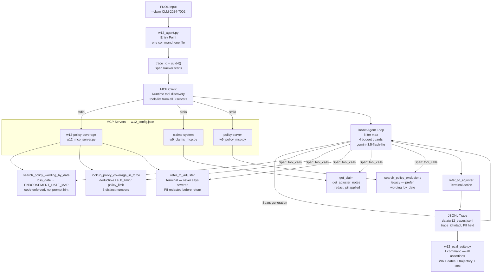

# W12 Architecture — Claims Triage & Coverage Assistant

## One-Page Overview

**Entry point:** `python w12_agent.py --claim CLM-XXXX`
**Eval suite:** `python w12_eval_suite.py`

A single `trace_id` (UUID) is assigned at FNOL entry and propagates through every span, MCP call, and JSONL log record.

---

## Architecture Diagram



---

## Where LLM Calls Happen

| Location | What | Model |
|----------|------|-------|
| `w12_agent.py` ReAct loop | Each iteration | `gemini-3.5-flash-lite` |
| `eval/judge_eval.py` | LLM-as-judge (25 cases) | `gemini-3.5-flash-lite` |

**No LLM calls inside MCP servers** — servers are pure data/logic providers.

---

## Where the Money Goes

| Span | % of Latency | % of Cost |
|------|-------------|-----------|
| MCP discovery | ~5% | <0.1% |
| Generation (LLM) | ~80% | ~99.5% |
| Tool calls (MCP) | ~15% | ~0.5% |

**Cost per claim (p50): \$0.000425** | **p95: \$0.000891**  
At 18,000 FNOLs/week (hailstorm): **\$7.65/week**. Rate limits break first, not cost.

---

## PII Boundary

```
Adjuster notes (raw PII)
        ↓
  get_adjuster_notes MCP wrapper
        ↓
  _redact_pii() ← HERE before any return
        ↓
  Agent context (PII-free)
        ↓
  JSONL trace (PII-free)  +  External squad MCP client (PII-free)
```

---

## Key Constraints

| Constraint | How Enforced |
|------------|-------------|
| Endorsement version = loss date | `ENDORSEMENT_DATE_MAP` in code; `search_policy_wording_by_date` picks by date range |
| Never says "covered" | System prompt + `refer_to_adjuster` scrubs + `assert_no_coverage_word()` in eval |
| 3 distinct financial figures | `lookup_policy_coverage_in_force` returns `deductible`, `sub_limits{}`, `policy_limit` |
| Single trace_id | UUID at FNOL, forwarded to all spans and JSONL |
| PII held | `_redact_pii()` at MCP boundary + agent context + JSONL write |

---

## File Map

```
d:\AI-Training\
├── w12_agent.py          ← Entry point
├── w12_mcp_server.py     ← W12 MCP server (date-scoped wording, in-force check, referral)
├── w12_config.json       ← 3 MCP servers
├── w12_eval_suite.py     ← Full eval suite (one command)
├── w12_error_taxonomy.py ← 7-mode taxonomy (3 integration-created)
├── w12_seam_list.md      ← Tuesday seam list (15 seams)
├── w12_architecture.md   ← This file
├── README.md             ← Stranger-ready setup
├── w7_agent.py           ← W7 base agent (still importable)
├── w7_tools.py           ← 4 domain tools
├── w9_claims_mcp.py      ← Claims MCP
├── w9_policy_mcp.py      ← Policy MCP (legacy)
├── utils/tracer.py       ← JSONL tracer + PII redaction
├── eval/run_w6_eval.py   ← W6 eval runner
└── data/
    ├── w12_traces.jsonl
    ├── endorsements/     ← HO-0304 through HO-0309
    └── w7_claims.json    ← 10 claims + ground truth
```
